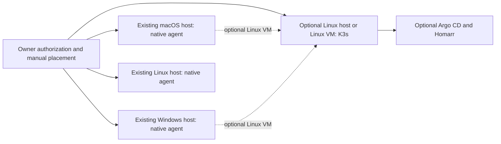

# DRAFT: dots-local-sidecar-cloud-infrastructure

Fleet product brief · 2026-11-01 · [Issue #1](https://github.com/newdarwindev/dots-local-sidecar-cloud-infrastructure/issues/1)

## Purpose and evidence

The proposed fleet layer coordinates **existing, individually authorized computers** through manual workload placement. Native macOS, Windows and Linux agents can perform supported host tasks. An optional Linux host or Linux VM can run container workloads. This independent layer does not change the native platform's one-personal-computer connection limit. Each host, identity and action needs its own authorization.

This repository contains drafts only. It has **no** enrollment service, agent controller, cluster manifests, backups, credential service, deployment or runtime test evidence. Machine count and specifications are unverified here. No capability has a verified **working**, **tested** or **prototype** status in this repository.

| Capability | Status | Evidence or gap |
| --- | --- | --- |
| Fleet architecture and inventory template | Draft | This brief and [blank inventory](docs/inventory-template.md) |
| Native execution on enrolled macOS, Windows and Linux hosts | Planned | No enrollment or execution test here |
| Manual placement and recovery | Planned | Procedure below; no restore drill |
| Optional K3s, Argo CD and Homarr | Planned | No installation or integration test |
| OpenBao delivery, rotation and encrypted profiles | Planned, separate [issue #2](https://github.com/newdarwindev/dots-local-sidecar-cloud-infrastructure/issues/2) | No implementation or test |

## Smallest useful architecture

K3s runs on Linux. A Linux VM on macOS or Windows is a **Linux guest**, not a native macOS or Windows Kubernetes node; it shares its physical host's power and availability. Argo CD could reconcile reviewed configuration; Homarr could show approved service links. Neither is required to start with native agents. No automatic scheduler, high availability layer or cloud expansion is assumed.

| Target | Native tasks | Optional containers | Prerequisites before use |
| --- | --- | --- | --- |
| macOS host | Planned, subject to agent support and authorization | Eligible Linux VM only | Supported OS/architecture, identity, consent and local resources |
| Windows host | Planned, subject to agent support and authorization | Eligible Linux VM only | Supported OS/architecture, identity, consent and local resources |
| Linux host | Planned, subject to agent support and authorization | K3s after validation | Supported distro/architecture, stable power, network, storage and recovery plan |
| Linux VM | Linux guest tasks after separate authorization | K3s after validation | Compatible image, virtualization, reserved RAM/disk, networking and host uptime |

This is a planning matrix, not a claim that actual devices passed prerequisites. Keep inventory private; use the [blank template](docs/inventory-template.md).

## Decisions for owner review

No option has been selected. Recommendations are discussion starters, not deployment approvals.

| Decision | A: recommended draft | B: alternative | Trade-off and gate |
| --- | --- | --- | --- |
| D1 execution | Native agents on supported macOS/Windows/Linux; Linux-only K3s workloads | Add Linux VMs on non-Linux hosts for containers | VMs add capacity and resource cost. Verify OS, architecture and authorization per machine. |
| D2 footprint | Document optional small K3s, Argo CD and Homarr stack | Begin with host services, no Kubernetes | Stack adds reconciliation and a dashboard with operational cost. Inventory first. |
| D3 recovery | Manual placement plus backup and restore plan | Export configuration snapshots before stateful workloads | A enables a restore drill; B limits early state. Neither gives automatic failover. |

Record one selected option per decision before implementation. A documentation choice does not authorize access, installation, spending or publication.

## Proposed acceptance procedure (not executed)

Use synthetic tasks and data. Record dated observations without hostnames, addresses, tokens, sessions or private links in this public repository.

1. **Authorization:** Given two individually authorized test hosts, manually choose one for a harmless task. Expect execution only there; an unapproved host request is denied and logged. An unauthorized cross-host action fails.
2. **OS boundary:** On each supported test OS, run a harmless native task and identify host OS and agent version. A container task on macOS/Windows must run only in an explicitly configured Linux guest. Report unsupported architecture or sleep as a placement failure, never silent migration.
3. **Optional stack:** If D2-A is chosen and separately authorized, check K3s health, Argo CD's approved scope and Homarr's approved links on one eligible Linux host/VM. Opening Homarr must not create a workload or secret. If D2-B is chosen, this step is inapplicable.
4. **Recovery:** Before stateful work, name data, backup destination class, encryption key custody and acceptable data loss. Restore a synthetic backup to a disposable target, compare checksums and measure elapsed time. Missing backup material or failed verification fails the gate.
5. **Evidence:** Record date, decision, prerequisites, expected and observed result, sanitized evidence and failure/rollback. Leave gates open until actually run.

There are no measured results or completed gates. See [trust and recovery boundaries](docs/boundaries-and-cloud.md), [sources](docs/sources.md) and the separate [credential proposal](https://github.com/newdarwindev/dots-local-sidecar-cloud-infrastructure/issues/2).
