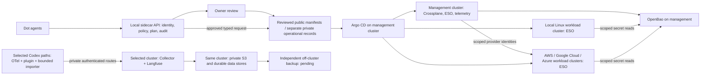

# DRAFT: dots-local-sidecar-cloud-infrastructure

Architecture and staged implementation · 2026-11-02 · No cluster, credential service, cloud resources, or agent controller has been deployed by this repository.

The [primary macOS host rollout](docs/primary-host-rollout.md) records the staged
bootstrap, public/private desired-state boundary, Homarr integration, approval scopes
and recovery checks. It is not an installed deployment or a verified GitOps loop.

[Primary infrastructure implementation](primary-infrastructure/README.md),
[action-time approval template](primary-infrastructure/APPROVAL.md) and
[Docker-only validation](.github/workflows/primary-infrastructure.yml) are staged
here. Only reviewed generic manifests belong in this public repository; actual
host records, private settings, credentials and recovery details remain private.

## Goal and assumptions

Build an agent-operable local cloud from owner-controlled macOS, Linux and Windows
computers, with optional separately approved cloud capacity. The private inventory,
not a fixed fleet count or this public template, determines discovered hosts and
observed capabilities. Discovery is not enrollment or readiness. Notebook sleep,
shared disks and untested recovery keep this a lab/pilot until measured; no
production high-availability claim is made.

## Documentation map

| Question | Authoritative document |
| --- | --- |
| Topology and component responsibilities | This architecture overview |
| Host evidence, eligibility and enrollment stages | [Fleet alignment](docs/fleet-alignment.md); actual host records stay private |
| Management bootstrap order and recovery acceptance | [Primary host rollout](docs/primary-host-rollout.md) |
| Exact pinned implementation and guarded actions | [Implementation runbook](primary-infrastructure/README.md) |
| Planned human identity, application access and domains | [Authentication and domains](docs/auth-domain-plan.md) |
| Codex sessions and private Langfuse observability | [Selected Langfuse design](docs/langfuse-plan.md); [OpenTelemetry implementation plan](docs/opentelemetry-implementation-plan.md) |
| Cloud, provider and agent trust boundaries | [Boundaries](docs/boundaries-and-cloud.md) |

The overview expresses intent; the implementation runbook describes only what
is staged. Planned components absent from manifests are not installed features.
Archived approval records do not authorize a new activation.

## Decisions

| Concern | Draft choice | Reason and boundary |
| --- | --- | --- |
| Cluster topology | One small **Linux-only management cluster** on an eligible, reliable Linux host or Linux VMs, plus one **local workload cluster** spanning eligible Linux nodes/VMs. | The clusters have separate control planes and credentials. They are independent failure domains only if placed on different physical hosts and power/network paths; co-hosted VMs share the notebook failure domain. One cluster per notebook would multiply certificates, upgrades, and GitOps targets without useful isolation at this scale. The management control plane is initially single-node with tested backup, not HA. If no host can stay awake, stop at planning. |
| Host OS | K3s runs on Linux hosts; macOS and Windows notebooks contribute Linux VMs only after virtualization, resource, and network checks. | K3s targets Linux. Native Windows workers require supported Windows Server and Linux control plane; ordinary Windows notebooks should not be assumed eligible. macOS is not a native Kubernetes node. VM CPU architecture must match available images. |
| GPU | Keep GPU host out of GPU scheduling until vendor/model, OS, drivers, passthrough, and device-plugin support are proven. | A GPU in a notebook does not imply accessible Kubernetes acceleration, especially through a VM. CPU scheduling remains possible. |
| Desired state | Git repository holds reviewed platform claims and Argo CD Applications; Argo CD reconciles approved cluster targets. Crossplane reconciles selected platform and cloud resources. | Git is the auditable intent boundary. Crossplane is not a substitute for GitOps approval or provider credentials. |
| Secrets | OpenBao as proposed OSS secret store; ESO runs in each destination cluster and syncs specifically authorized values to namespaced Kubernetes Secrets in that cluster. | Store encrypted backups and unseal/recovery material outside the cluster. Use separate OpenBao policies and auth mounts per cluster. ESO integration is an acceptance gate because provider support status can change. No secret values in Git. |
| Agent control | Dot agent formation proposes typed operations through a local sidecar gateway and policy engine; human approval gates sensitive changes. | Agents never receive a shared root credential or unrestricted kubeconfig. Existing Tether work is a possible integration boundary, not deployed infrastructure. |

## Architecture

The management cluster owns reconciliation, inventory, audit, and secrets. Workloads run on the local workload cluster or on separately enrolled cloud clusters. Cloud extension means explicit placement and data movement, **not** transparent failover. Each cloud cluster has its own network, identity, quotas, cost budget, and Argo CD destination allowlist. Do not stretch etcd or storage across the internet.

## Agent operations contract

A request includes actor identity, target cluster/namespace, resource kind, desired change, reason, expiry, idempotency key, estimated effect, and rollback plan. The gateway authenticates the agent, validates a typed schema, checks policy and quotas, generates a diff/plan, and records an immutable audit reference. Read-only inventory and status may be delegated. New cluster enrollment, new provider identity, secret policy, privileged workload, public ingress, destructive action, cloud spend, and production promotion require owner approval of the exact plan. On approval, a narrow bot writes a pull request to the **approved desired-state repository** (this public repository for reviewed generic manifests; private settings and operational records stay outside it); branch protection and review precede Argo CD sync. The gateway cannot mint its own permissions. Break-glass access is time-limited, logged, and held by the owner outside agent runtime.

## Rollout and operations

Use the [fleet enrollment gates](docs/fleet-alignment.md) before choosing placement.
Follow the [primary rollout](docs/primary-host-rollout.md) for management bootstrap,
backup/restore, Homarr acceptance and rollback, and the
[implementation runbook](primary-infrastructure/README.md) for exact guarded actions.
These are one sequence, not parallel competing installation instructions.

Only after management recovery works, enroll a separately approved workload
cluster. Crossplane composition APIs and cloud providers remain later work under
[the cloud boundaries](docs/boundaries-and-cloud.md): review provider identity,
quotas, deletion behavior, data residency, egress and teardown before activation.
Do not stretch etcd/storage across the internet or infer HA from co-hosted guests.

Use the [auth/domain plan](docs/auth-domain-plan.md) for application access design;
current loopback access and local credentials remain unchanged until separately
approved, tested migration. No IdP, domain registration or DNS changes occur here.

## Open decisions and risks

Actual capabilities and remaining unknowns are recorded privately; GPU scheduling compatibility still requires workload-level validation. The management host might be unavailable, making automated reconciliation unavailable. Running OpenBao on the same small management cluster creates a bootstrap and recovery concentration risk. ESO support for OpenBao should be validated against pinned versions. Crossplane provider breadth and cloud identities need per-provider review. Mixed CPU architectures and notebook sleep can break image scheduling and storage. Cloud egress and spend require hard limits. This draft creates no infrastructure and contains no account credentials.

See [trust boundaries and cloud plan](docs/boundaries-and-cloud.md) and [primary sources](docs/sources.md).
