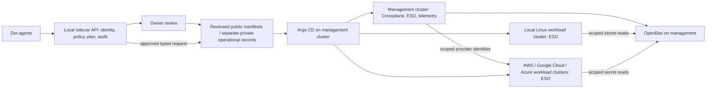

# DRAFT: dots-local-sidecar-cloud-infrastructure

Architecture and staged implementation · 2026-11-02 · No cluster, credential service, cloud resources, or agent controller has been deployed by this repository.

The [primary macOS host rollout](docs/primary-host-rollout.md) records the staged
bootstrap, public/private desired-state boundary, Homarr integration, approval scopes
and recovery checks. It is not an installed deployment or a verified GitOps loop.

[Primary infrastructure implementation](primary-infrastructure/README.md),
[action-time approval template](primary-infrastructure/APPROVAL.md) and
[Docker-only validation](.github/workflows/primary-infrastructure.yml) are staged
here. Only reviewed generic manifests belong in this public repository; actual
host records, private settings, credentials and recovery details remain private.

## Goal and assumptions

Build an agent-operable local cloud from eight owner-controlled notebooks (macOS, Linux, and Windows; one with an unspecified GPU), with optional AWS, Google Cloud, and Azure capacity. The inventory, CPU architectures, GPU model, RAM, networking, power behavior, and cloud accounts are **unknown**. A notebook may sleep or leave the network; this is a lab or pilot architecture until availability and recovery are measured. No production high-availability claim is made.

## Decisions

| Concern | Draft choice | Reason and boundary |
| --- | --- | --- |
| Cluster topology | One small **Linux-only management cluster** on an eligible, reliable Linux host or Linux VMs, plus one **local workload cluster** spanning eligible Linux nodes/VMs. | The clusters have separate control planes and credentials. They are independent failure domains only if placed on different physical hosts and power/network paths; co-hosted VMs share the notebook failure domain. One cluster per notebook would multiply certificates, upgrades, and GitOps targets without useful isolation at this scale. The management control plane is initially single-node with tested backup, not HA. If no host can stay awake, stop at planning. |
| Host OS | K3s runs on Linux hosts; macOS and Windows notebooks contribute Linux VMs only after virtualization, resource, and network checks. | K3s targets Linux. Native Windows workers require supported Windows Server and Linux control plane; ordinary Windows notebooks should not be assumed eligible. macOS is not a native Kubernetes node. VM CPU architecture must match available images. |
| GPU | Keep GPU host out of GPU scheduling until vendor/model, OS, drivers, passthrough, and device-plugin support are proven. | A GPU in a notebook does not imply accessible Kubernetes acceleration, especially through a VM. CPU scheduling remains possible. |
| Desired state | Git repository holds reviewed platform claims and Argo CD Applications; Argo CD reconciles approved cluster targets. Crossplane reconciles selected platform and cloud resources. | Git is the auditable intent boundary. Crossplane is not a substitute for GitOps approval or provider credentials. |
| Secrets | OpenBao as proposed OSS secret store; ESO runs in each destination cluster and syncs specifically authorized values to namespaced Kubernetes Secrets in that cluster. | Store encrypted backups and unseal/recovery material outside the cluster. Use separate OpenBao policies and auth mounts per cluster. ESO integration is an acceptance gate because provider support status can change. No secret values in Git. |
| Agent control | Dot agent formation proposes typed operations through a local sidecar gateway and policy engine; human approval gates sensitive changes. | Agents never receive a shared root credential or unrestricted kubeconfig. Existing Tether work is a possible integration boundary, not deployed infrastructure. |

## Architecture

The management cluster owns reconciliation, inventory, audit, and secrets. Workloads run on the local workload cluster or on separately enrolled cloud clusters. Cloud extension means explicit placement and data movement, **not** transparent failover. Each cloud cluster has its own network, identity, quotas, cost budget, and Argo CD destination allowlist. Do not stretch etcd or storage across the internet.

## Agent operations contract

A request includes actor identity, target cluster/namespace, resource kind, desired change, reason, expiry, idempotency key, estimated effect, and rollback plan. The gateway authenticates the agent, validates a typed schema, checks policy and quotas, generates a diff/plan, and records an immutable audit reference. Read-only inventory and status may be delegated. New cluster enrollment, new provider identity, secret policy, privileged workload, public ingress, destructive action, cloud spend, and production promotion require owner approval of the exact plan. On approval, a narrow bot writes a pull request to the **approved desired-state repository** (this public repository for reviewed generic manifests; private settings and operational records stay outside it); branch protection and review precede Argo CD sync. The gateway cannot mint its own permissions. Break-glass access is time-limited, logged, and held by the owner outside agent runtime.

## Planned integration sequence

1. Inventory all eight machines using [the blank template](docs/inventory-template.md). Verify power, disk, CPU architecture, virtualization, network reachability, GPU details, and whether one Linux control-plane host can remain available.
2. Establish distinct physical placement for the two clusters if failure isolation is required, then a private management network, stable host naming, OS patching, disk encryption, time sync, firewall rules, and SSH/device identity. Choose local and cloud CIDRs that do not overlap.
3. Bootstrap the Linux management cluster manually with a pinned K3s version and explicit embedded etcd initialization (`--cluster-init`); a default single-server K3s install otherwise uses SQLite. Keep the single-server etcd topology non-HA. Store encrypted etcd snapshots **and the matching K3s server token** off-host under owner control; test restore before onboarding another machine. These are architecture instructions, not an installation command.
4. Initialize and unseal OpenBao under an owner-held recovery procedure. Configure separate identities/policies for management, local workload, and each cloud cluster. The bootstrap credential remains offline and is revoked or rotated after service identities are established.
5. Install Argo CD from a reviewed release and bootstrap one tightly scoped root Application. Configure Argo CD annotation-based resource tracking for Crossplane-managed objects to avoid ownership conflicts. Install Crossplane and only needed providers on management, then ESO on management and separately in every enrolled destination cluster, each with a validated OpenBao integration and cluster-specific scoped identity. Pin versions and restrict Argo CD projects and destinations. Avoid a controller dependency cycle: OpenBao recovery and the root GitOps path must work without ESO.
6. Enroll the local workload cluster with least-privilege credentials. Add Linux workers/VMs one at a time and prove architecture-compatible images, node sleep handling, and drain/rejoin behavior. Gate GPU onboarding separately.
7. Introduce composition/XRD APIs for a small set of owner-approved platform services. The agent requests a claim; Crossplane performs the authorized reconciliation; Argo CD manages the claim source and controller configuration. Test deletion policy and orphan detection.
8. Add cloud providers one at a time only after account/IAM, budgets, networking, image architecture, data residency, egress, and teardown plans are approved. Prefer workload identity/federation over stored long-lived cloud keys where supported. Verify policy and billing alerts before any resource creation.

## Operations and recovery

Collect Kubernetes events, controller health, reconciliation errors, resource use, power/sleep state, and agent audit records. Use a lightweight metrics/logging stack sized to actual hardware; decide retention after measuring capacity. Back up etcd snapshots, OpenBao storage and recovery metadata, Git repositories, and persistent workload data separately, encrypted and off-host. Practice restoring management first, then secrets, GitOps, and workload state. A notebook outage can make its local storage unavailable; placement and replica policy must reflect measured reliability. Set explicit recovery objectives after testing, not before.

## Acceptance gates

- [ ] Inventory and placement constraints reviewed; stable management host identified.
- [ ] Network and trust boundaries tested; no overlapping CIDRs or public control-plane endpoint by default.
- [ ] Management restore and OpenBao recovery tested from off-host backups.
- [ ] Argo CD sync scoped to approved repositories, projects, namespaces, and clusters.
- [ ] ESO rotation and revocation tested in each destination cluster; no plaintext secret in Git, logs, or agent context.
- [ ] Crossplane composition and deletion behavior tested in a disposable target.
- [ ] Agent request, owner-reviewed plan, audit record, denial, and rollback demonstrated end to end.
- [ ] Node sleep/rejoin, architecture compatibility, and backup recovery tested.
- [ ] Each cloud extension has reviewed IAM, cost ceiling, egress path, teardown, and data classification.

## Open decisions and risks

Machine details and GPU compatibility are unknown. The management host might be unavailable, making automated reconciliation unavailable. Running OpenBao on the same small management cluster creates a bootstrap and recovery concentration risk. ESO support for OpenBao should be validated against pinned versions. Crossplane provider breadth and cloud identities need per-provider review. Mixed CPU architectures and notebook sleep can break image scheduling and storage. Cloud egress and spend require hard limits. This draft creates no infrastructure and contains no account credentials.

See [trust boundaries and cloud plan](docs/boundaries-and-cloud.md) and [primary sources](docs/sources.md).
