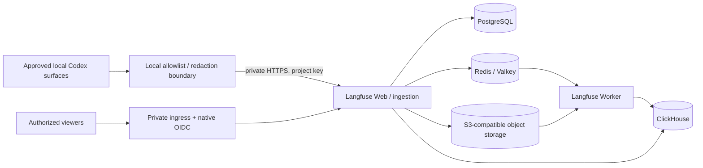

# Langfuse: fleet session observability plan

**Research and installation draft · 2026-11-02 · Not deployed.** No collectors,
hooks, accounts, keys, services, DNS, retention policies or GitOps sync are enabled
by this document. Use the [fleet gates](fleet-alignment.md) and
[shared identity/domain policy](auth-domain-plan.md); actual placement stays in the
private overlay. This adds an observability workload, not another secrets or
identity system. Coverage is measured per authorized session surface, not promised
for every account or cloud session.

## Recommended shape

The [upstream architecture](https://langfuse.com/self-hosting) has separate web and
worker containers; PostgreSQL holds transactional state, ClickHouse observations,
Redis/Valkey queues/cache, and object storage ingestion payloads/media/exports.
An external LLM is not needed merely to collect traces. Leave paid inference,
playground/evaluation integrations and in-app agents off unless separately approved.

Use one logical private observability hub, initially a non-HA pilot. Prefer the
vendor Helm chart only after an existing Linux cluster passes readiness checks;
otherwise a separately budgeted Linux VM with vendor Compose is a simpler bounded
pilot. Neither choice automatically adopts a host or replaces an existing cluster.
Do not insert this data stack into the small management guest by default.

## Version, capacity and installation gates

- [Compose guidance](https://langfuse.com/self-hosting/deployment/docker-compose)
  recommends at least **4 cores, 16 GiB RAM and approximately 100 GiB storage** for
  its VM example. This is a starting budget, not a measured fleet requirement or
  high-availability design. Compose supplies no backup solution. Measure event
  volume, indexing amplification, queue backlog and growth with synthetic data
  before committing a resource reservation; leave host OS/workload headroom.
- Current online docs describe **v4**. Pin a reviewed Langfuse release, image
  digests, chart and dependency versions together; do not combine legacy v3 YAML
  with current docs or follow mutable `latest` tags. The plugin's minimum server
  version is not a recommendation to install that old version.
- [Current Helm prerequisites](https://langfuse.com/self-hosting/deployment/kubernetes-helm)
  include Kubernetes >=1.28 for the bundled ClickHouse operator. With default
  `clickhouse.deploy: true`, chart >=2.0.0 requires ClickHouse operator CRDs and
  cert-manager beforehand. An all-external-data-store deployment need not install
  that operator merely for Langfuse. The chart can use external data stores; current bundled blob storage is SeaweedFS. Inspect the exact chart's
  RBAC, CRDs, dependency images, PVCs and upgrade path; operator installation is a
  separate cluster-wide change, not implicit approval from this plan.
- [Current image documentation](https://langfuse.com/self-hosting/configuration/hardening)
  lists amd64 and arm64 app images. Validate **every dependency image and chart**
  for the chosen architecture; app image support does not prove an entire ARM
  deployment. Do not silently emulate database workloads on a constrained laptop.
- Reserve independent durable PVCs/data paths; verify storage class, ownership,
  encryption, actual backing capacity and thin-pool metadata. Shared disks are not
  redundancy. Specify requests/limits after pilot measurements, plus alerts for
  disk, queue age, failed ingestion and clock drift. GPU capacity is irrelevant.

Planned steps after explicit activation: (1) refresh placement evidence;
(2) lock versions and render/review configuration; (3) establish independent
bootstrap/recovery custody; (4) provision private storage and dependencies;
(5) start web/worker and run schema readiness checks; (6) bootstrap only approved
organization/project/users and narrow ingestion keys; (7) synthetic trace and
access/restore tests; (8) enroll one explicitly approved source surface; then
expand by evidence. No executable deployment manifests are staged in this change.

## Access, names and secrets

Propose `app_id=langfuse`, `role_id=observability-hub`,
`endpoint_id=langfuse-ui`, `auth_profile=native-oidc`, `lifecycle=proposed`.
Use `langfuse.apps.example.invalid` as an inert canonical HTTPS example; record
real DNS and certificates in the existing private catalog, not this repository.
[Networking docs](https://langfuse.com/self-hosting/security/networking) require
only the web interface/API to be reachable by clients (internal web default 3000).
Keep worker health and all database, queue, object-store and operator endpoints
private. Permit only version-verified internal component ports, never blanket
host networking/public database ports. TLS verification stays enabled.

Use Authentik through [native OIDC](https://langfuse.com/self-hosting/security/authentication-and-sso):
prefer the dedicated Authentik provider when the pinned release supports it.
Otherwise use the documented custom provider only after a separate compatibility
review (`AUTH_CUSTOM_*`, exact `/api/auth/callback/custom` redirect). Verify the
chosen provider's exact configuration/callback and correct `NEXTAUTH_URL`; do not
mix dedicated-provider and custom-provider variables. Test issuer/claims, MFA, explicit membership, least privilege,
logout, disabled users and recovery. Keep account linking off unless verified
email ownership and migration semantics are reviewed. Disabling signup also
blocks new invited users: bootstrap/test the approved onboarding sequence first.
Do not remove working recovery authentication before proving its replacement.

**Licensing:** current [self-host pricing](https://langfuse.com/pricing-self-host)
lists SSO and RBAC in OSS. Project-level RBAC, management APIs, retention policies
and audit logs are listed as Enterprise additions. Verify the pinned release and
exact required feature; do not assume a paid license for basic custom OIDC, or
promise all fine-grained authorization/audit features for free. No purchase or
commercial enrollment is requested here.

Machine ingestion uses supported project credentials, not browser cookies or an
interactive SSO redirect. Enforce TLS, project separation and narrow network
reachability; do not claim project keys are write-only or host-scoped without
verification. Separate projects/keys where isolation requires it. Revocation of
one source must not require replacing a human SSO session. Never exempt all
`/api/*` from authentication; only tested machine paths retain their native auth.

Generate secrets only during approved bootstrap, outside Git/tool output. Keep
application encryption/session secrets, data-store credentials and project keys
in approved secret storage; ESO/OpenBao integration follows existing narrow
policies. Independently recoverable bootstrap custody must exist before OpenBao
or the IdP is available. Langfuse cannot be the only record of its own recovery.
For OSS propose `TELEMETRY_ENABLED=false` on both application containers; current
[telemetry docs](https://langfuse.com/self-hosting/security/telemetry) distinguish
OSS opt-out from commercial license telemetry. Review remaining update/browser
requests and egress rather than equating that switch with zero network activity.

## Codex integration choices

| Path | What it can establish | Constraints / decision |
| --- | --- | --- |
| [Official Codex plugin](https://langfuse.com/integrations/developer-tools/codex), [source](https://github.com/langfuse/codex-observability-plugin) | Stop-hook transcript reconstruction, per-turn traces and session grouping, generations/tools/subagents/tokens | Preferred rich-trace pilot **only after explicit content approval**. Docs require Codex >=0.143, Node >=22/npm, hooks enabled, Langfuse >=3.95.0. Review pinned hook code/hash. Its broad content capture is not metadata-only; do not enable it fleet-wide under a telemetry assumption. |
| Native Codex OTel via reviewed filtering/transform | Live operational spans and allowlisted metadata, depending on emitted events | Preferred metadata-only research/pilot path. Logs, traces and metrics are separate exporters. Langfuse accepts OTLP HTTP traces, not arbitrary log/metric payloads or gRPC. Validate mapping/usage fields on synthetic sessions; no assertion that it creates full conversational replay. |
| SDK/app-server instrumentation | Sessions/jobs launched by an explicitly instrumented client | Useful controlled-job boundary, not capture of unrelated desktop/CLI/cloud sessions. Use the SDK for local-thread automation and app server for custom clients; do not revive removed `codex mcp-server` recipes. |
| [Community historical importer](https://github.com/kirilligum/codex-langfuse-tracer) | Potential bounded local rollout import | Not vendor supported; schema/version/privacy/security review and synthetic tests first. Never start its watcher or scan all accounts by default. Prefer a reviewed adapter with strict field allowlist for metadata-only import. |

References: [Codex configuration](https://learn.chatgpt.com/docs/config-file/config-reference),
[OTel implementation](https://github.com/openai/codex/blob/main/codex-rs/otel/README.md),
[Langfuse OTel](https://langfuse.com/integrations/native/opentelemetry),
[Codex SDK](https://learn.chatgpt.com/docs/codex-sdk).
The metadata-only filter/transform is a proposed adapter, not an installed or
validated capability of the official plugin. The trace-specific HTTP endpoint is
`/api/public/otel/v1/traces`; a generic SDK base endpoint is `/api/public/otel`.
Preserve required root spans and propagate approved session metadata to each
span. Unknown attributes can reach Langfuse metadata, so use a positive field
allowlist rather than only removing a few familiar secret fields.

Native Codex final-answer logs are not equivalent to trace-export content. An OTLP
transport success alone is not semantic compatibility. For a version supporting
Langfuse v4 real-time ingestion, verify its ingestion-version header and visibility
latency rather than interpreting a delayed UI row as permission to resend blindly.

## Coverage and privacy contract

| Surface | New sessions | Historical sessions | Required evidence before claiming coverage |
| --- | --- | --- | --- |
| Authorized CLI account on each host | Hook or filtered OTel candidate | Bounded approved importer candidate | Exact binary/config, allowed data root, test session and confirmed hub record |
| `codex exec` / CI job | Explicit configured invocation | Only retained authorized artifacts | Short-lived worker/exporter flush and job-to-session linkage |
| Desktop / app-server | Version-specific instrumentation candidate | Only accessible, authorized retained history | Actual service names/config propagation and emitted trace; do not infer support or lack of support from CLI alone |
| WSL / native Windows / VM | Distinct source environments | Duplicate histories possible | Identity reconciliation and source ownership; no automatic double enrollment |
| Hosted/cloud-managed session | Unknown unless supported export/config is exposed | Unknown unless authorized export exists | Provider-supported interface and approval; never claim global/session-independent capture |
| Unavailable, denied or other-account roots | Not enrolled | Not read or imported | Report coverage gap, not a workaround |

Default exported schema is allowlisted metadata: pseudonymous stable host ID,
source surface/version, session ID, job ID (explicitly supplied or `unknown`),
turn/event ID, UTC time, model, duration, status, token counters with provenance
and schema version. No prompts, filenames/full paths, repo contents, tool I/O,
images, system/developer instructions, credentials, reasoning summaries or raw
error messages by default. Review whether even model/job labels contain private
information; sanitize before transport. Full content needs separately bounded
source/project/viewer/retention consent and tested local masking. Server-side
masking does not undo a secret already transmitted.

Use a stable source namespace and canonical session/turn/event identity; copied
histories retain their original source identity. Maintain a private dedup ledger,
importer version, checkpoint and source digest without committing raw paths.
Do not sum cumulative token snapshots; preserve whether each field is delta or
cumulative, cached input, output or unavailable. Missing usage is unknown, not zero.
A bounded backfill records time range/session allowlist, counts, rejected records
and a resumable checkpoint. Replaying the same fixture twice must not change totals.
Plugin-side dedup is not proof of cross-importer or cross-host deduplication.
Choose one canonical producer per session, or reconcile before importing overlaps.

Langfuse token/cost estimates are **not ChatGPT subscription quota accounting**.
Keep Tokscale's native reporting schedule and accounting workflow separate; join
by stable IDs where permitted instead of summing both copies. No six-hour collector
is introduced. Quota-limit errors can be evidence of a limit, not exact per-job
subscription spend or proof that all consuming jobs were observed.

## Preservation, upgrades and acceptance

Preserve all original Tether, chat, decision and session histories, including
attachments and dedup receipts. A redacted derivative or Langfuse trace is not an
archive substitute. This plan authorizes no deletion, truncation or rotation.
Any proposed retention applies only to approved derivative data and requires an
explicit retention decision; do not silently enable TTLs or paid retention APIs.

Use the [backup guide](https://langfuse.com/self-hosting/configuration/backups)
to design encrypted off-host recovery for PostgreSQL, ClickHouse and its
coordination state, object storage and required queue state, plus separately
protected configuration/encryption material. Agree RPO/RTO before activation;
backup on the same physical disk is not off-host recovery. Restore to an isolated
instance and verify user/project authorization, session counts, IDs and token
fixtures. Document queue drain/replay semantics, not only database dump success.

Before upgrades, read release-specific migration notes, rehearse on an isolated
restore and preserve a consistent pre-upgrade recovery point. Do not assume a
container downgrade reverses database migrations. Never turn on v4 dual-write or
migration switches from generic docs without a matched, reviewed upgrade plan.

Acceptance checklist: synthetic multi-turn/tool/child-session fixture; deliberate
secret canary absent in transmitted/exported payload; exact usage provenance;
repeat import and exporter retry do not duplicate; failure is visible without
blocking the user's coding session; denied viewer/source key rejected; certificate
verification, offline queue bounds and crash/exit flush tested; isolated restore
meets RPO/RTO; all enrolled surfaces appear in a dated private coverage register.
Only then recommend a separately approved bounded expansion. Hooks are fail-open
observability, not a complete compliance/audit guarantee.
